# Stunning Touch

> **Your Everyday Tools, All in One Place.**


**Stunning Touch** is a free, all-in-one online tools platform with a fully integrated AI-powered blogging pipeline. All file-processing tools run **100% in the browser** — images, PDFs and text never leave the visitor's device — while the Laravel backend provides a modern admin panel, a privacy-conscious analytics stack, and an end-to-end automated blog authoring system.

**Website:** [https://stunningtouch.com](https://stunningtouch.com)

---

## Screenshots

All screenshots were captured from the real application running locally (dark theme is the default; a light theme is available in the admin top bar).

### Public website

| Homepage | All Tools |
|---|---|
| 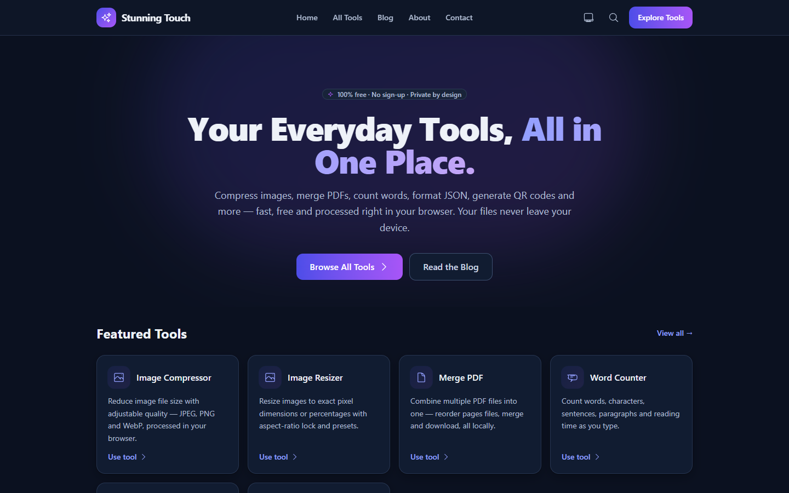 | 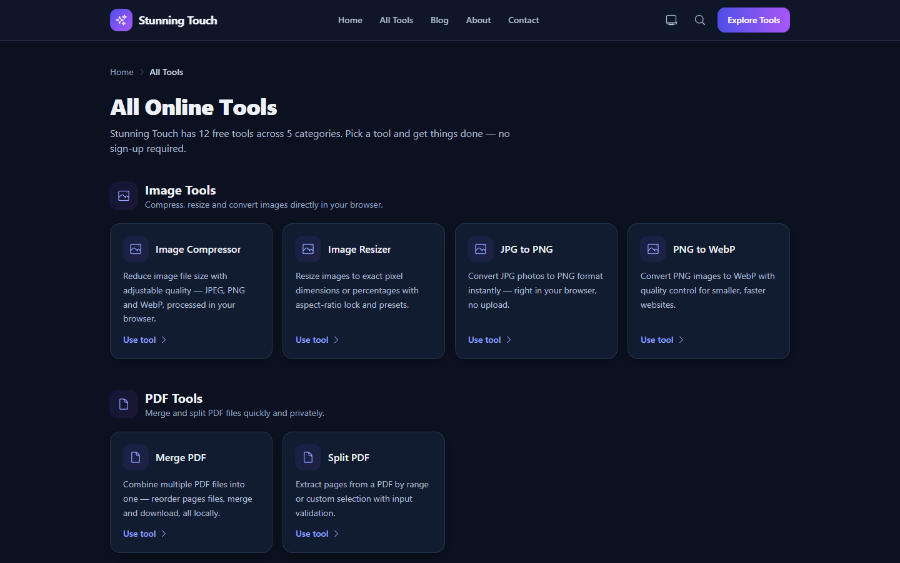 |

| PDF Tools category | Merge PDF tool |
|---|---|
| 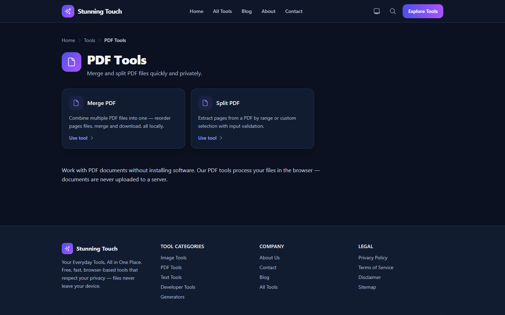 | 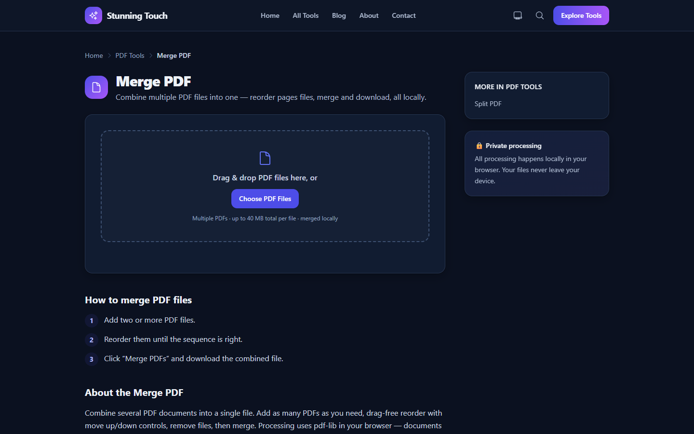 |

| Blog | Blog article |
|---|---|
| 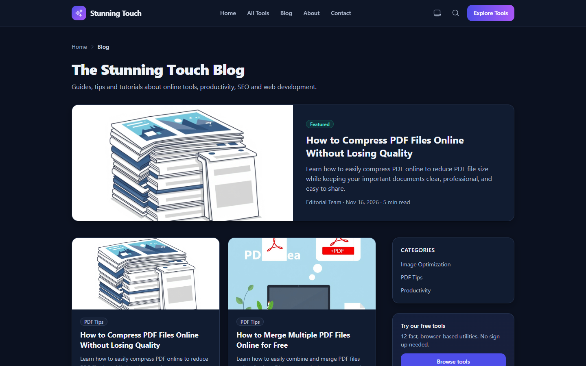 | 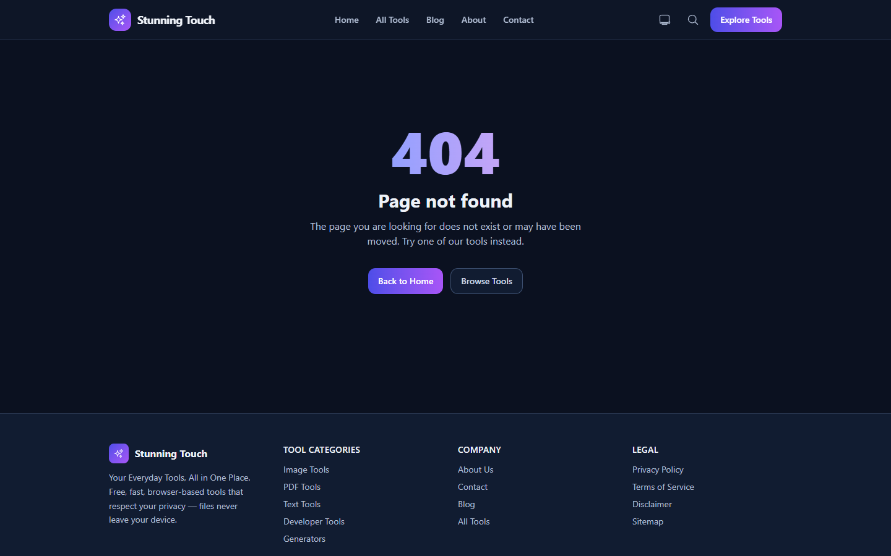 |

### Admin panel

| Dashboard | Admin password management |
|---|---|
| 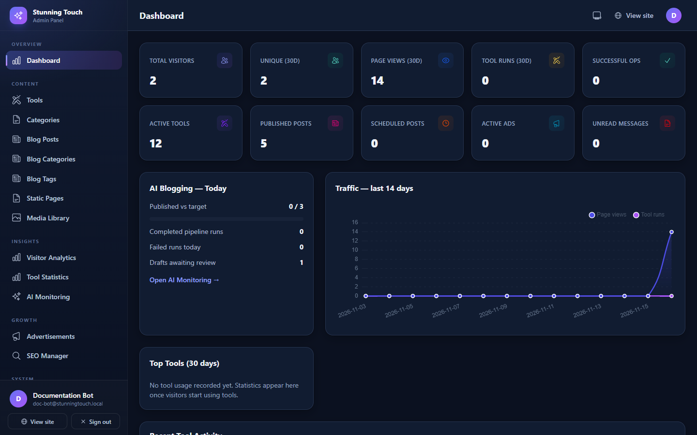 | 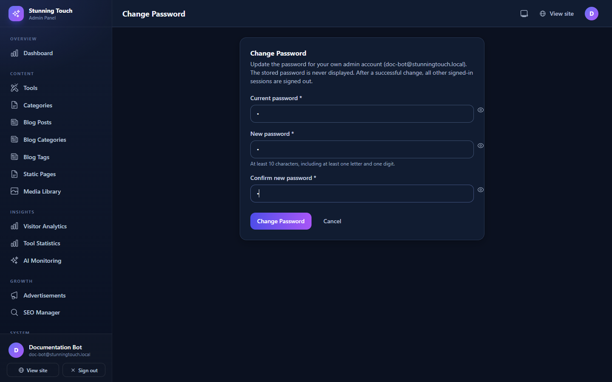 |

| AI provider settings with model discovery | Automation settings |
|---|---|
| 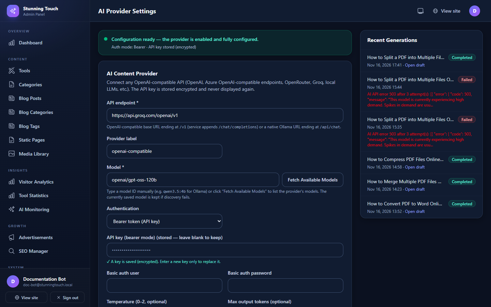 | 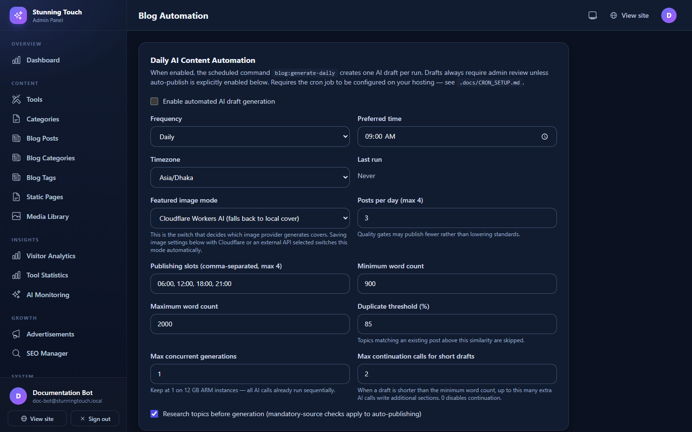 |

| Manual blog generation | Blog posts overview |
|---|---|
| 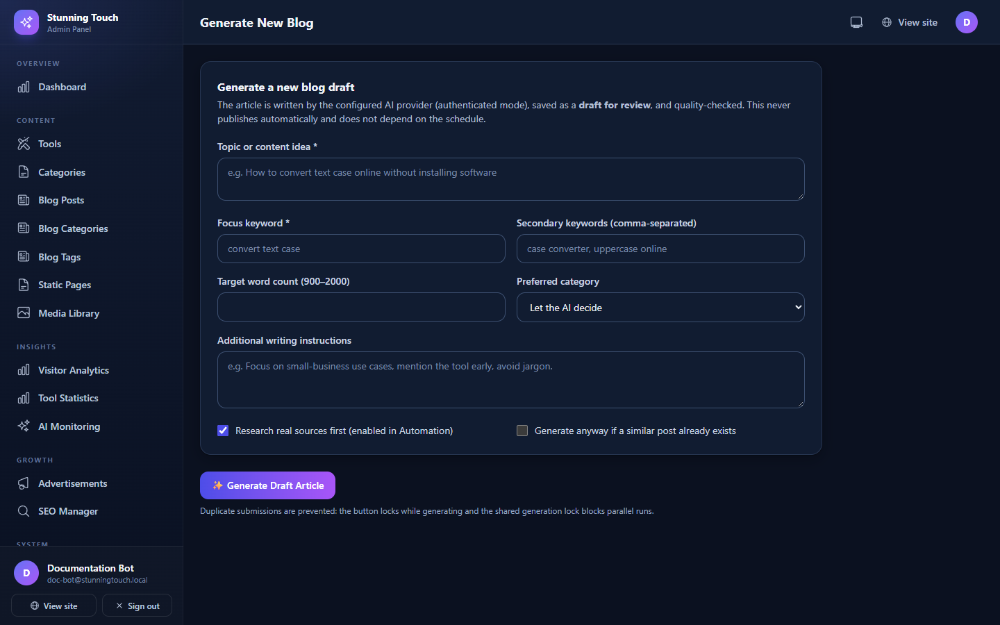 | 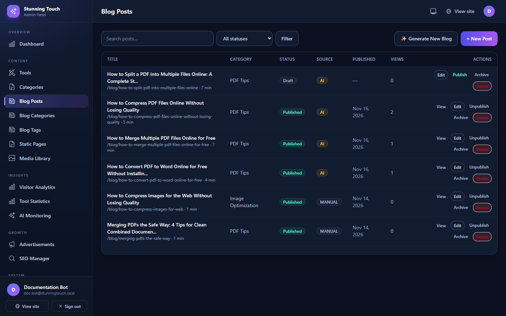 |

No screenshot displays API keys, tokens, passwords or any other credential: provider credentials are stored encrypted in the database and never rendered in the UI.

---

## Project Overview

Stunning Touch serves two audiences:

1. **Visitors** — twelve fast, privacy-first online tools (image, PDF, text, developer utilities and generators), plus an editorial blog. No sign-up, no upload, no tracking of processed content.
2. **Administrators** — a single, complete admin panel for managing tools, categories, SEO, advertisements, static pages, the media library, visitor analytics, AI monitoring, and an autonomous AI blogging pipeline that researches, writes, validates, illustrates and drafts articles for human review.

The project is designed for **shared hosting (cPanel) deployment** — no Node.js, no SSH and no background daemons are required in production — while keeping full local development ergonomics.

## Features

### Public website & tools

| Feature | Status |
|---|---|
| 12 browser-based tools (image compressor/resizer, JPG→PNG, PNG→WebP, merge/split PDF, word counter, case converter, JSON formatter, Base64, QR generator, UUID generator) | ✅ Implemented |
| Database-driven tools & categories with a safe component registry | ✅ Implemented |
| Per-page SEO management (titles, descriptions, keywords, Open Graph/Twitter, robots, schema) | ✅ Implemented |
| Technical SEO: canonical URLs, XML sitemap, `robots.txt`, structured data | ✅ Implemented |
| Privacy-conscious visitor analytics (rotating daily visitor hash — no raw IPs) | ✅ Implemented |
| Tool-usage statistics (real processing events only) | ✅ Implemented |
| Universal advertisement manager (any network, placements, targeting, scheduling) | ✅ Implemented |
| Static pages (About, Privacy Policy, Terms, Disclaimer) with contact form | ✅ Implemented |
| Blog CMS for visitors (listing, categories, articles) | ✅ Implemented |

### Admin panel

| Feature | Status |
|---|---|
| Secure session login with throttling and audit logging | ✅ Implemented |
| Admin account password change (current-password verification, hashing, other-session invalidation) | ✅ Implemented |
| Admin user management | ✅ Implemented |
| Media library with daily-quota enforcement | ✅ Implemented |
| Audit logs and contact-message inbox | ✅ Implemented |
| Light/dark theme | ✅ Implemented |

### AI blogging system

| Feature | Status |
|---|---|
| OpenAI-compatible provider integration (OpenAI, Groq, OpenRouter, Gemini-compatible, local Ollama) | ✅ Implemented |
| Dynamic model discovery via `Fetch Available Models` | ✅ Implemented |
| Connection testing and model-availability checks with diagnostics | ✅ Implemented |
| Encrypted credential storage (never displayed or logged) | ✅ Implemented |
| Research pipeline (HackerNews + Wikipedia) with provenance tracking | ✅ Implemented |
| Keyword discovery and SEO scoring | ✅ Implemented |
| Article generation with target word counts and bounded continuation | ✅ Implemented |
| Quality validation (word count, internal links, HTTP link checks, duplicates, SEO) | ✅ Implemented |
| Article-specific featured-image prompts (FLUX.1 via Cloudflare Workers AI) with local fallback | ✅ Implemented |
| Draft-first workflow: nothing auto-publishes without a passing quality report | ✅ Implemented |
| Scheduler automation (daily/weekly, quality-gated) | ✅ Implemented |
| AI monitoring dashboard | ✅ Implemented |

### Planned / not yet implemented

- More tools (timer, stopwatch, color picker, image cropper, …).
- Multi-language content.
- Additional research providers beyond HackerNews and Wikipedia.
- Newsletter / RSS subscriptions.

## Technology Stack

| Component | Version | Purpose |
|---|---|---|
| PHP | ≥ 8.3 | Runtime |
| Laravel | 13.x | Framework |
| MySQL | 5.7+/8.x (production), SQLite (development) | Database |
| Tailwind CSS | 4.x (Vite plugin) | Styling |
| Alpine.js | 3.x | Admin UI interactivity |
| Chart.js | 4.x | Admin dashboard graphs |
| pdf-lib | 1.x | In-browser PDF processing |
| qrcode | 1.x | QR generation |
| d3-geo / topojson-client / world-atlas | 3.x / 3.x / 2.x | Visitor map visualization |
| Vite | 7.x | Frontend bundler |
| PHPUnit | 12.x | Testing |

## Architecture Overview

```mermaid
flowchart LR
    subgraph Browser["Visitor's browser"]
        T1["Tools (Canvas API, pdf-lib)<br/>processing stays local"]
    end

    subgraph Laravel["Laravel 13"]
        subgraph Public["Public site"]
            H["Home / Tools / Blog"]
            SEO["Sitemap, robots, schema"]
            AN["Analytics & tool-usage beacons"]
        end
        subgraph Admin["Admin panel"]
            AUTH["Session auth + EnsureAdmin<br/>CSRF + throttling"]
            CMS["Tools, blog, SEO, ads, media"]
            AIS["AI Provider Settings<br/>(model discovery, connection test)"]
            AUTO["Automation settings"]
            MON["Monitoring"]
        end
        subgraph Pipeline["AI blogging pipeline"]
            RS["ResearchService"]
            KW["KeywordService"]
            GEN["BlogGeneratorService<br/>(generation + continuation)"]
            QV["QualityValidatorService"]
            IMG["ImageService"]
            LOCK["Generation lock"]
        end
        SCH["Scheduler"]
    end

    subgraph External["External services (admin-configured, encrypted credentials)"]
        AI["OpenAI-compatible API<br/>(OpenAI / Groq / OpenRouter / Gemini / Ollama)"]
        CF["Cloudflare Workers AI<br/>FLUX.1 [schnell]"]
    end

    subgraph DB[("MySQL / SQLite")]
        DATA["settings, tools, posts,<br/>analytics, media, sessions…"]
    end

    T1 --> H
    T1 --> AN
    H --> DATA
    CMS --> DATA
    AUTH --> CMS
    SCH --> PIPE[Pipeline]
    AUTO --> PIPE
    RS --> KW --> GEN --> QV --> IMG
    LOCK --> GEN
    GEN <--> AI
    IMG <--> CF
    QV --> DATA
    IMG --> DATA
    MON --> DATA
```

Key architectural properties:

- **Draft-first AI publishing**: every generated article is a draft until a quality report passes (and auto-publish is explicitly enabled).
- **Shared generation lock**: only one AI generation runs at a time, even across manual and scheduled triggers.
- **Environment-aware URLs**: all internal-link generation and validation derive from `config('app.url')` — no hardcoded production domain.
- **Encrypted settings**: provider API keys are stored with Laravel's encrypted casts and never displayed, logged or echoed.

## Requirements

Verified against the actual development and deployment setup:

| Requirement | Version |
|---|---|
| PHP | 8.3+ |
| Composer | 2.x |
| Node.js | 20+ (development machine only) |
| npm | 10+ (development machine only) |
| MySQL | 5.7+ / 8.x (SQLite works for local development out of the box) |

Laravel's optional extras (Redis, queue workers, WebSockets) are **not required** — the project intentionally avoids them for shared hosting.

## Local Installation

```bash
# 1. Clone
git clone git@github.com:san-ratul/stunning-touch.git stunning-touch
cd stunning-touch

# 2. Install dependencies
composer install
npm install

# 3. Configure environment
cp .env.example .env
php artisan key:generate

# 4. Database (SQLite by default — no server needed)
#    For MySQL, set DB_CONNECTION=mysql and fill the DB_* variables.
php artisan migrate
php artisan db:seed

# 5. Build frontend assets
npm run build

# 6. Start the development server
php artisan serve
```

Default admin account created by the seeder: **`admin@stunningtouch.com` / `ChangeMe123!`** — *change it immediately after your first login* via **Admin → My Account → Change Password**. The seeder only creates this account when no user with that email exists, and never overwrites an existing password.

## Environment Configuration

All variables are documented with placeholder values in [`.env.example`](.env.example). Important notes:

- `APP_URL` — the site's canonical URL. Internal-link generation for AI articles, quality validation and endpoint guards all derive from this value; set it to your local domain or the production URL.
- `SCHEDULER_SECRET` — protects the `/run-scheduler/{secret}` web-cron endpoint on shared hosting. Use a long random string.
- **AI provider credentials are not stored in `.env`.** Endpoints, API keys, models and image-provider tokens are configured through the admin panel and stored encrypted in the database.

## AI Provider Configuration

1. **Admin → AI Provider** — enter any OpenAI-compatible base URL (OpenAI, Azure-compatible, Groq, OpenRouter, Gemini's OpenAI-compatible endpoint, or a local Ollama server).
2. Choose the authentication mode: Bearer token, none (local Ollama), or Basic auth.
3. Click **Fetch Available Models** — the backend queries the provider's model-list endpoint (`GET {base}/models`, or `GET {base}/api/tags` for native Ollama), deduplicates and sorts the results, and fills a searchable dropdown. Manual model IDs remain supported as a fallback for providers without a listing endpoint.
4. Click **Test Connection** to verify authentication, model accessibility and that the provider actually returns visible assistant content (a reasoning-model-safe output budget is used; HTTP 200 with empty content is reported as a failure with diagnostics).
5. Click **Check Model Availability** to confirm the selected model is listed *and* callable.
6. **Save** — the API key is stored with Laravel's encrypted cast and never shown again; a stored key is preserved when the field is left blank.

Security: model discovery runs through the backend only (never from the browser), validates endpoint URLs (http/https only, cloud-metadata addresses blocked, local Ollama hosts allowed), and never echoes credentials.

## AI Blogging System

The pipeline (manual via *Admin → Generate New Blog*, or scheduled):

1. **Topic discovery** — picks a topic from configured seed keywords, guided by recent posts to avoid duplicates.
2. **Research** — fetches public sources (Hacker News, Wikipedia); every source is stored with its URL and timestamp for provenance.
3. **Keyword selection** — SEO-focused keyword discovery per topic.
4. **Generation** — Gemini/OpenAI-compatible chat completion writes the article JSON (title, slug, excerpt, clean HTML content, SEO metadata), respecting the target word count and never dropping below the configured minimum.
5. **Continuation** — if the draft is short, up to a configurable number of extra calls write *new, non-repeating* sections; reasoning-model output-budget exhaustion is retried once with a doubled (capped) budget, with token usage aggregated across attempts.
6. **Quality validation** — word count bounds, internal links to real tool pages (HTTP-verified), duplicate-content scoring, SEO field checks. Results are persisted as a QualityReport.
7. **Featured image** — an article-specific prompt (derived from title/focus keyword/content) is sent to Cloudflare Workers AI (FLUX.1 [schnell]); the image is stored in the media library, cropped to 1200×630, and associated with the draft. Failures fall back to the local branded cover and never block the article.
8. **Draft persistence & review** — manual generation never publishes. Scheduled generation publishes only when auto-publish is enabled *and* the quality report passes.

## Scheduler Setup

The scheduler is driven by Laravel's `schedule:run`. On servers with SSH access, register the standard cron entry:

```cron
* * * * * cd /path/to/project && php artisan schedule:run >> /dev/null 2>&1
```

On shared hosting without SSH, a protected web-cron endpoint is available:

```
GET https://stunningtouch.com/run-scheduler/{SCHEDULER_SECRET}
```

Point your provider's cron job at that URL (rate-limited to 2 requests/minute). Generate a long random `SCHEDULER_SECRET` and rotate it if it leaks.

## Testing

```bash
php artisan test      # full suite
vendor/bin/pint       # code style (fix), add --test to check only
npm run build         # frontend production build
```

The suite covers admin authentication and password management, AI provider integration (request shapes, retries, budgets, discovery, encryption), the blogging pipeline (research, generation, continuation, quality validation, images), tool administration, analytics and the public pages. All external API traffic is mocked in tests — no real API quota is consumed.

## Production Deployment (shared hosting)

The included `deploy/` folder documents a cPanel-style deployment:

1. **Build locally** (your dev machine has Node.js): `npm run build` → the compiled `public/build` assets are part of the deployment package. Production hosting does not need Node.js.
2. **Package** — `deploy/build-deploy-package.ps1` builds the release zip (source + built assets, no `vendor/`).
3. **Upload & install** — follow `deploy/INSTALL.txt`: upload the zip, extract, copy `.env` (see `deploy/.env.production.template`), point the webroot, run `php artisan migrate --force` via cPanel's terminal or the web-cron.
4. The web-cron entry (above) drives the daily scheduler.
5. No Redis, queue workers or WebSockets are required: sessions, cache and queue use the database connection.

## Database & Seeders

- **Migrations** create the full schema: tools, categories, SEO metadata, blog posts/categories/tags, static pages, site settings, ad placements, media, analytics, audit logs, users, AI/automation/image settings, research runs and sources, generation records, quality reports and usage tracking.
- **`DatabaseSeeder`** is idempotent (`firstOrCreate` everywhere): it creates the default admin (only if missing), site settings, the 5 categories and 12 tools with SEO metadata, ad placements, static pages, two sample blog posts, and default (disabled) AI/automation settings.
- Seeders never touch existing user data, never overwrite existing admin passwords, and never seed API keys — encrypted credential fields are empty by default.
- Fresh install: `php artisan migrate && php artisan db:seed`.

## Security

- **Environment files**: `.env` is gitignored; `.env.example` contains placeholders only. Provider API keys live encrypted in the database, not in env files.
- **Encrypted credentials**: Laravel `encrypted` casts for API keys and basic-auth passwords; keys are never displayed, logged or returned in responses.
- **Admin authorization**: session authentication + `EnsureAdmin` middleware + CSRF on all state-changing routes; login is throttled (5/min) and all auth events are audit-logged.
- **Password management**: bcrypt hashing via Laravel's `hashed` cast, current-password verification, policy-validated new passwords, and `AuthenticateSession` middleware so every other signed-in session is invalidated after a change.
- **Endpoint validation & SSRF protection**: admin-triggered outbound requests (model discovery, connection tests) validate URLs (http/https only, cloud-metadata addresses blocked) while preserving intentional local-Ollama support.
- **Privacy**: no raw IP storage, rotating daily visitor hashes, all visitor file-processing stays in the browser.
- **Web-cron protection**: the scheduler endpoint requires a secret with constant-time comparison and is rate-limited.

## Project Structure

```
app/
  Console/Commands/        Scheduled commands (AI blogging pipeline, etc.)
  Enums/                   System and domain enums
  Http/Controllers/Admin/  Admin panel controllers (auth, CMS, AI, settings)
  Http/Controllers/Public/ Public site controllers
  Http/Middleware/         EnsureAdmin, TrackVisitor, SecurityHeaders
  Models/                  Eloquent models (settings, tools, blog, analytics…)
  Services/Ai/             AI pipeline services (provider, generator,
                           quality validator, research, keywords, images)
  Services/Research/       Research providers and result models
  Support/                 SiteUrl, EndpointGuard, SEO helpers
database/
  migrations/              Full schema
  seeders/                 Idempotent default data
resources/
  css/, js/                Tailwind 4 + Alpine + vanilla tool scripts
  views/admin/, views/public/, views/tools/
routes/web.php             Public + admin + protected scheduler routes
tests/                     Feature & unit suites (322 tests)
deploy/                    Shared-hosting deployment scripts & templates
docs/screenshots/          README screenshots (real application)
```

## Contributing

Contributions are welcome!

1. Fork the repository and create a feature branch.
2. Follow the existing code style (`vendor/bin/pint` must pass).
3. Add or update tests for behavior changes; keep the full suite green (`php artisan test`).
4. Never commit credentials, real `.env` files, or generated screenshots of the admin panel containing private data.
5. Open a pull request describing the change and the test evidence.

## License

This project is open-sourced under the [MIT license](LICENSE).

## Acknowledgements

- [Laravel](https://laravel.com) — application framework
- [Tailwind CSS](https://tailwindcss.com) — styling
- [Alpine.js](https://alpinejs.dev) — UI interactivity
- [Chart.js](https://www.chartjs.org) — admin dashboard charts
- [pdf-lib](https://pdf-lib.js.org) — in-browser PDF processing
- [qrcode](https://github.com/soldair/node-qrcode) — QR generation
- [Cloudflare Workers AI](https://developers.cloudflare.com/workers-ai/) — FLUX.1 featured-image generation
- [Groq](https://groq.com) / [OpenAI](https://openai.com) / [Google Gemini](https://ai.google.dev) / [Ollama](https://ollama.com) — OpenAI-compatible text generation providers
